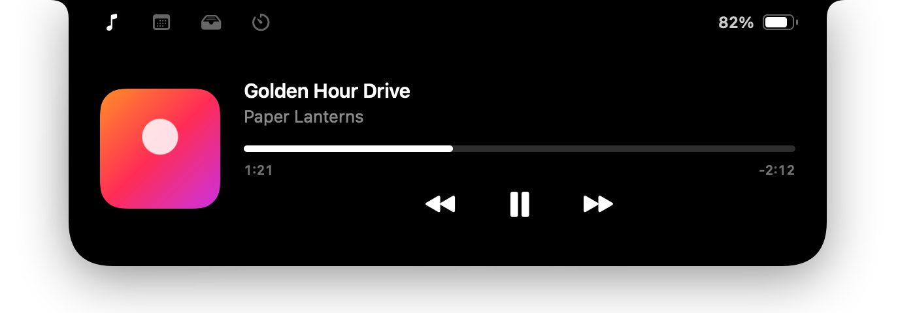
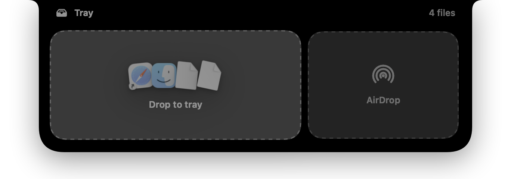
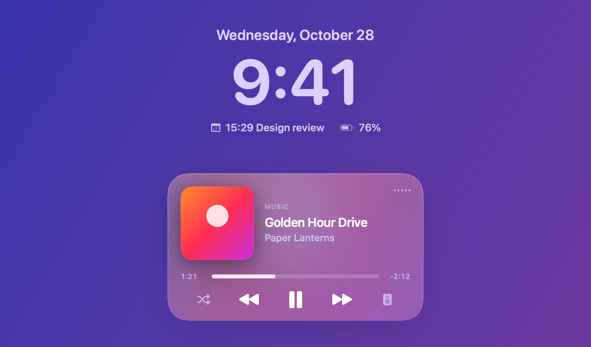
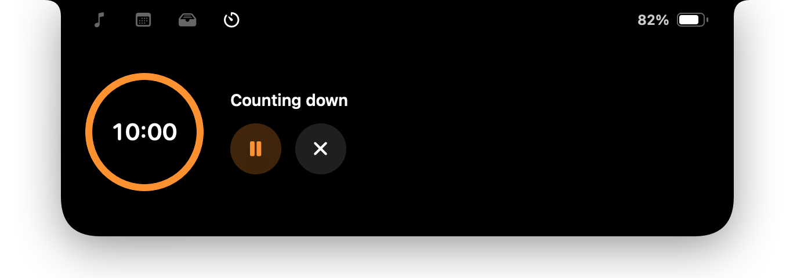
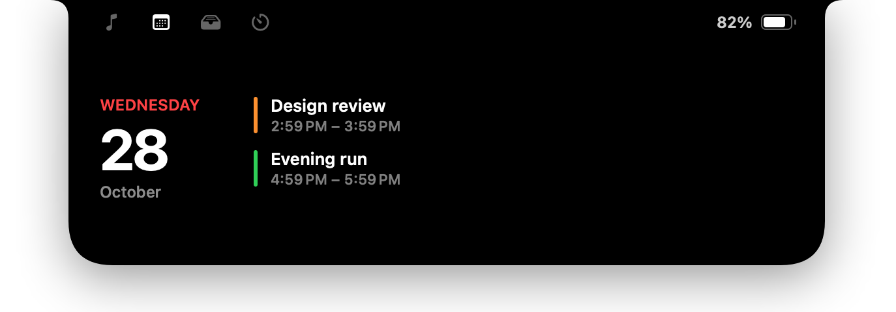

<p align="center">
  
</p>

<h1 align="center">Inlet</h1>

<p align="center">
  <b>Your notch, put to work.</b><br>
  A free, open-source notch app for macOS: Now Playing, a file tray with AirDrop,<br>
  quick timers, lock-screen widgets and calmer volume &amp; brightness HUDs.
</p>

<p align="center">
  <a href="https://github.com/Kaandis/inlet/releases/latest"></a>
  
  
  <a href="LICENSE"></a>
</p>

<p align="center">
  <a href="https://kaandis.github.io/inlet/">Website</a> ·
  <a href="https://github.com/Kaandis/inlet/releases/latest/download/Inlet.zip">Download</a> ·
  <a href="README.tr.md">Türkçe</a>
</p>

<p align="center">
  
</p>

## What it does

| | |
|---|---|
| **Now Playing** — Apple Music and Spotify with cover art, a scrubber and controls. A small live activity sits beside the notch while music plays; swipe sideways on the trackpad to skip. |  |
| **Tray & AirDrop** — bring a file toward the notch and the tray opens. Drop it on the left to park it, on the right to AirDrop it. Drag files back out whenever you need them. |  |
| **Lock screen** — the island stays on the lock screen, with a Now Playing card and two small widgets you choose: Focus, weather, battery or your next event. |  |
| **Quick timer** — 1, 5, 10 or 25 minutes in one tap; the countdown lives in the notch. |  |
| **Calendar & small alerts** — today's events with a nudge five minutes before, plus charging, low battery, AirPods/Bluetooth and Caps Lock. |  |
| **Calmer HUDs** — volume and brightness glide out of the notch instead of landing on your work. |  |

Also: two-finger swipe down to open and up to close, haptic feedback, launch at login, a small island on displays without a notch, and English and Turkish.

## Why it works this way

- **Springs, not timers.** Every motion starts from where it currently is and can be reversed halfway, so the island feels physical rather than scripted. It only bounces when your swipe gave it momentum.
- **Click to open, by default.** Hover-to-open is one switch away in Settings, but off at first: moving the cursor across the menu bar shouldn't throw panels at you.
- **A twin window for the lock screen.** Windows that sit above the lock screen never receive drag-and-drop. So the island you use all day is a normal window, and an identical twin takes over only while the Mac is locked.
- **The tray keeps references, not copies.** Nothing is duplicated on disk; files stay exactly where they are.
- **Quiet Bluetooth alerts.** AirPods open short background connections all the time (automatic switching, battery sync). Inlet only announces a connection once audio is actually routed to the device.
- **Weather without an account.** Forecasts come from [Open-Meteo](https://open-meteo.com) — free and keyless. The city you type is the only thing that leaves your Mac.
- **Asks only when needed.** Each permission belongs to one feature. Skip it and everything else keeps working.
- **Native and light.** SwiftUI and AppKit. No Electron, no web views, no analytics.

## Install

1. Download **[Inlet.zip](https://github.com/Kaandis/inlet/releases/latest/download/Inlet.zip)** from the latest release and unzip it.
2. Move **Inlet.app** to your Applications folder.
3. The first time, right-click Inlet and choose **Open**. Builds aren't notarized yet, so macOS asks once. If it still refuses:

```bash
xattr -dr com.apple.quarantine /Applications/Inlet.app
```

Inlet lives in the menu bar (the capsule icon). Settings has four tabs: General, Features, Lock Screen and About.

## Permissions

| Permission | Used for | Asked when |
|---|---|---|
| Automation (Music, Spotify) | Reading and controlling what's playing | Music or Spotify is running for the first time |
| Calendars | Today's events and the five-minute heads-up | You open the calendar tab and allow access |
| Bluetooth | "AirPods connected" notices | First launch with Bluetooth alerts on |
| Full Disk Access *(optional)* | Showing the active Focus on the lock screen | Only if you pick the Focus widget |

## Privacy

No analytics, no account, no telemetry. The only network request is the weather widget, which sends the city you chose to Open-Meteo. Tray items, settings and everything else stay on your Mac.

## Build from source

Requirements: Xcode 16 or later and [XcodeGen](https://github.com/yonaskolb/XcodeGen).

```bash
brew install xcodegen
git clone https://github.com/Kaandis/inlet.git
cd inlet
xcodegen generate
open Inlet.xcodeproj
```

Debug builds can render every island state to PNG — handy for reviewing UI changes without screen-recording permission:

```bash
xcodebuild -project Inlet.xcodeproj -scheme Inlet -derivedDataPath build/dd build
build/dd/Build/Products/Debug/Inlet.app/Contents/MacOS/Inlet --render-previews ./previews -AppleLanguages "(en)"
```

<details>
<summary>Project layout</summary>

| Path | What's there |
|---|---|
| `Inlet/Island` | The panel, notch shape, state model, controller (mouse, swipes, drops) and views |
| `Inlet/Features/Media` | Music and Spotify via Apple Events |
| `Inlet/Features/Tray` | File tray and AirDrop |
| `Inlet/Features/LockScreen` | Lock-screen space, twin window, widgets |
| `Inlet/Features/{Battery,Calendar,Timer,Bluetooth,Weather,Focus,HUD}` | One service per feature |
| `Inlet/Settings` | Settings window, preferences, language picker |
| `Inlet/Resources/*.xcstrings` | Translations |
| `docs/` | The website (GitHub Pages) |

</details>

## Translations

Inlet speaks English and Turkish and follows your system language; you can also pick one in **Settings → General**. Strings live in [`Inlet/Resources/Localizable.xcstrings`](Inlet/Resources/Localizable.xcstrings) — open it in Xcode, add a language, and send a pull request.

## Known limitations

- The lock-screen window and the brightness HUD rely on private macOS interfaces (SkyLight, DisplayServices). A future macOS update could break them until Inlet catches up.
- The system's own volume/brightness HUD still appears alongside Inlet's.
- Now Playing supports Apple Music and Spotify; browsers and other players aren't covered yet.

## Acknowledgements

- [SkyLightWindow](https://github.com/Lakr233/SkyLightWindow) (MIT) by Lakr233 for documenting the lock-screen space technique.
- [mew-notch](https://github.com/monuk7735/mew-notch) for writing down that lock-screen windows don't receive drag-and-drop.
- [Open-Meteo](https://open-meteo.com) for free weather data.

## Disclaimer

Inlet is an independent project and is not affiliated with, endorsed by or sponsored by Apple Inc. Mac, MacBook, AirDrop and AirPods are trademarks of Apple Inc., registered in the U.S. and other countries. Spotify is a trademark of Spotify AB.

## License

[MIT](LICENSE)
