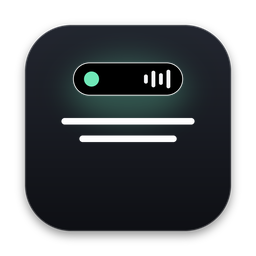
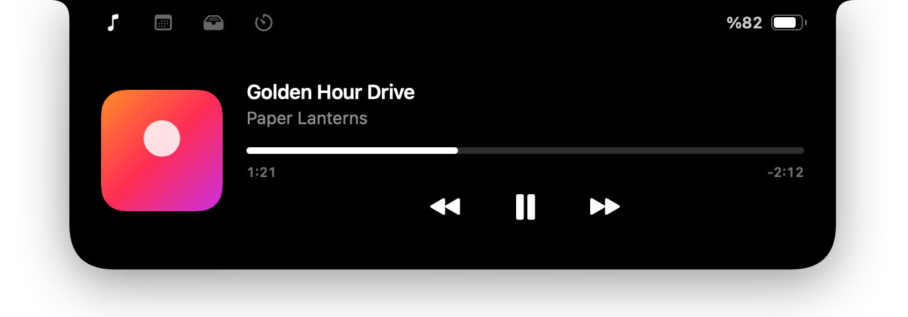
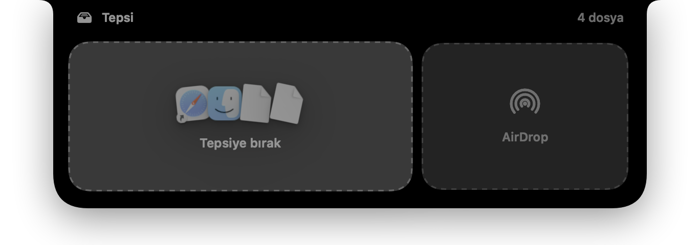
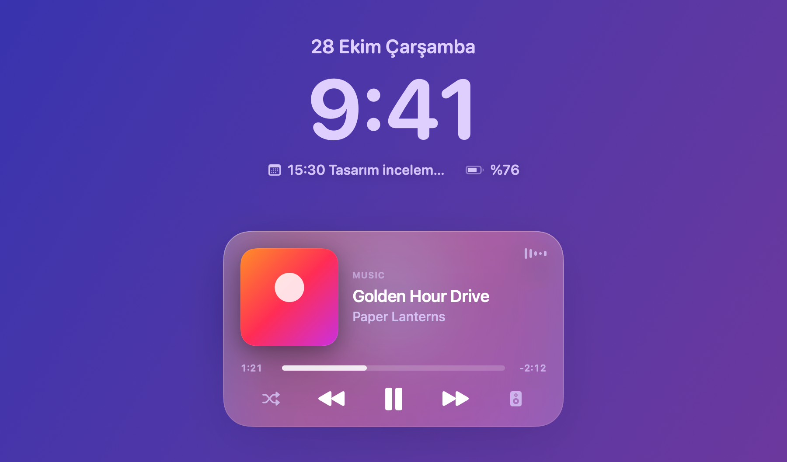
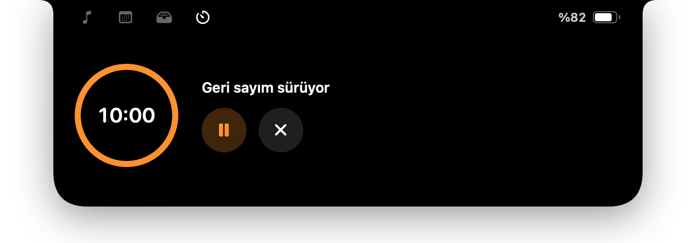
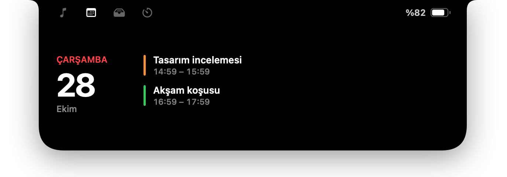

<p align="center">
  
</p>

<h1 align="center">Inlet</h1>

<p align="center">
  <b>Çentiğin artık işe yarıyor.</b><br>
  macOS için ücretsiz ve açık kaynak bir çentik uygulaması: şu an çalan, AirDrop'lu dosya tepsisi,<br>
  hızlı zamanlayıcılar, kilit ekranı widget'ları ve daha sakin ses ve parlaklık göstergeleri.
</p>

<p align="center">
  <a href="https://github.com/Kaandis/inlet/releases/latest"></a>
  
  
  <a href="LICENSE"></a>
</p>

<p align="center">
  <a href="https://kaandis.github.io/inlet/">Web sitesi</a> ·
  <a href="https://github.com/Kaandis/inlet/releases/latest/download/Inlet.zip">İndir</a> ·
  <a href="README.md">English</a>
</p>

<p align="center">
  
</p>

## Neler yapıyor

| | |
|---|---|
| **Şu an çalan**: Apple Music ve Spotify; kapak, ilerleme çubuğu ve kontrollerle. Müzik çalarken çentiğin yanında küçük bir canlı etkinlik durur; şarkı atlamak için trackpad'de yana kaydır. |  |
| **Tepsi ve AirDrop**: bir dosyayı çentiğe yaklaştır, tepsi açılsın. Sola bırakırsan dosya bekler, sağa bırakırsan AirDrop ile gider. Dosyaları istediğin zaman geri sürükleyebilirsin. |  |
| **Kilit ekranı**: ada kilit ekranında da kalır; bir müzik kartı ve seçtiğin iki küçük widget ile: Odak, hava durumu, pil ya da sonraki etkinlik. |  |
| **Hızlı zamanlayıcı**: tek dokunuşla 1, 5, 10 ya da 25 dakika; geri sayım çentikte kalır. |  |
| **Takvim ve küçük uyarılar**: bugünkü etkinlikler ve beş dakika önce hatırlatma; ayrıca şarj, pil zayıf, AirPods/Bluetooth ve Caps Lock. |  |
| **Daha sakin HUD'lar**: ses ve parlaklık, işinin üstüne düşmek yerine çentikten süzülerek çıkar. |  |

Ayrıca: iki parmakla aşağı kaydırınca açılır, yukarı kaydırınca kapanır; dokunsal geri bildirim, girişte başlatma, çentiksiz ekranlarda küçük bir ada, İngilizce ve Türkçe.

## Neden böyle çalışıyor

- **Zamanlayıcı değil, yay.** Her hareket o anki konumundan başlar ve yarıda tersine dönebilir; ada senaryolu değil fiziksel hissettirir. Yalnızca kaydırman ona ivme verdiyse sekme olur.
- **Varsayılan olarak tıkla aç.** Üzerine gelince açılma ayarlarda bir anahtar uzağında ama başta kapalı: imleci menü çubuğunda gezdirmek üstüne paneller fırlatmamalı.
- **Kilit ekranı için ikiz pencere.** Kilit ekranının üstünde duran pencereler sürükle-bırak olaylarını hiç almıyor. Bu yüzden gün boyu kullandığın ada normal bir pencere; birebir aynı ikizi yalnızca Mac kilitliyken devreye girer.
- **Tepsi kopya değil, referans tutar.** Diskte hiçbir şey çoğalmaz; dosyalar olduğu yerde kalır.
- **Sessiz Bluetooth uyarıları.** AirPods arka planda sürekli kısa bağlantılar açar (otomatik geçiş, pil senkronu). Inlet bir bağlantıyı ancak ses gerçekten o aygıta yönlendiğinde duyurur.
- **Hesapsız hava durumu.** Tahminler [Open-Meteo](https://open-meteo.com)'dan gelir: ücretsiz ve anahtarsız. Mac'inden çıkan tek şey yazdığın şehir.
- **Yalnızca gerektiğinde ister.** Her izin tek bir özelliğe ait. Birini atlarsan gerisi çalışmaya devam eder.
- **Yerel ve hafif.** SwiftUI ve AppKit. Electron yok, web görünümü yok, analiz yok.

## Kurulum

1. Son sürümden **[Inlet.zip](https://github.com/Kaandis/inlet/releases/latest/download/Inlet.zip)** dosyasını indirip aç.
2. **Inlet.app**'i Uygulamalar klasörüne taşı.
3. İlk seferde Inlet'e sağ tıklayıp **Aç**'ı seç. Sürümler henüz notarize edilmediği için macOS bir kez sorar. Yine de açılmazsa:

```bash
xattr -dr com.apple.quarantine /Applications/Inlet.app
```

Inlet menü çubuğunda yaşar (kapsül simgesi). Ayarlar'da dört sekme var: Genel, Özellikler, Kilit Ekranı ve Hakkında.

## İzinler

| İzin | Ne için | Ne zaman istenir |
|---|---|---|
| Otomasyon (Music, Spotify) | Çalan şarkıyı okumak ve kontrol etmek | Music ya da Spotify ilk kez açıkken |
| Takvimler | Bugünkü etkinlikler ve beş dakika önce hatırlatma | Takvim sekmesinde erişime izin verdiğinde |
| Bluetooth | "AirPods bağlandı" bildirimleri | Bluetooth uyarıları açıkken ilk açılışta |
| Tam Disk Erişimi *(isteğe bağlı)* | Kilit ekranında etkin Odak'ı göstermek | Yalnızca Odak widget'ını seçersen |

## Gizlilik

Analiz yok, hesap yok, telemetri yok. Tek ağ isteği hava durumu widget'ı; o da seçtiğin şehri Open-Meteo'ya gönderir. Tepsideki dosyalar, ayarlar ve geri kalan her şey Mac'inde kalır.

## Kaynaktan derleme

Gerekenler: Xcode 16 veya üstü ve [XcodeGen](https://github.com/yonaskolb/XcodeGen).

```bash
brew install xcodegen
git clone https://github.com/Kaandis/inlet.git
cd inlet
xcodegen generate
open Inlet.xcodeproj
```

Debug derlemeleri adanın her durumunu PNG olarak çizebilir; ekran kaydı izni olmadan arayüz değişikliklerini incelemek için kullanışlı:

```bash
xcodebuild -project Inlet.xcodeproj -scheme Inlet -derivedDataPath build/dd build
build/dd/Build/Products/Debug/Inlet.app/Contents/MacOS/Inlet --render-previews ./previews -AppleLanguages "(tr)"
```

<details>
<summary>Proje yapısı</summary>

| Yol | İçerik |
|---|---|
| `Inlet/Island` | Panel, çentik şekli, durum modeli, controller (fare, kaydırma, bırakma) ve görünümler |
| `Inlet/Features/Media` | Apple Events ile Music ve Spotify |
| `Inlet/Features/Tray` | Dosya tepsisi ve AirDrop |
| `Inlet/Features/LockScreen` | Kilit ekranı katmanı, ikiz pencere, widget'lar |
| `Inlet/Features/{Battery,Calendar,Timer,Bluetooth,Weather,Focus,HUD}` | Her özellik için bir servis |
| `Inlet/Settings` | Ayarlar penceresi, tercihler, dil seçimi |
| `Inlet/Resources/*.xcstrings` | Çeviriler |
| `docs/` | Web sitesi (GitHub Pages) |

</details>

## Çeviriler

Inlet İngilizce ve Türkçe konuşur ve sistem dilini takip eder; istersen **Ayarlar → Genel**'den birini seçebilirsin. Metinler [`Inlet/Resources/Localizable.xcstrings`](Inlet/Resources/Localizable.xcstrings) dosyasında. Xcode'da açıp bir dil ekleyerek pull request gönderebilirsin.

## Bilinen sınırlamalar

- Kilit ekranı penceresi ve parlaklık HUD'ı macOS'un özel arayüzlerine (SkyLight, DisplayServices) dayanır. Bir macOS güncellemesi, Inlet güncellenene kadar bunları bozabilir.
- Sistemin kendi ses ve parlaklık göstergesi Inlet'inkiyle birlikte görünmeye devam eder.
- Şu an çalan, Apple Music ve Spotify'ı destekler; tarayıcılar ve diğer oynatıcılar henüz yok.

## Teşekkürler

- Kilit ekranı katmanı tekniğini belgelediği için Lakr233'ün [SkyLightWindow](https://github.com/Lakr233/SkyLightWindow) projesi (MIT).
- Kilit ekranı pencerelerinin sürükle-bırak almadığını kayda geçirdiği için [mew-notch](https://github.com/monuk7735/mew-notch).
- Ücretsiz hava durumu verisi için [Open-Meteo](https://open-meteo.com).

## Uyarı

Inlet bağımsız bir projedir; Apple Inc. ile bağlantılı değildir, Apple tarafından onaylanmamış veya desteklenmemiştir. Mac, MacBook, AirDrop ve AirPods, Apple Inc.'in ABD'de ve diğer ülkelerde tescilli ticari markalarıdır. Spotify, Spotify AB'nin ticari markasıdır.

## Lisans

[MIT](LICENSE)
